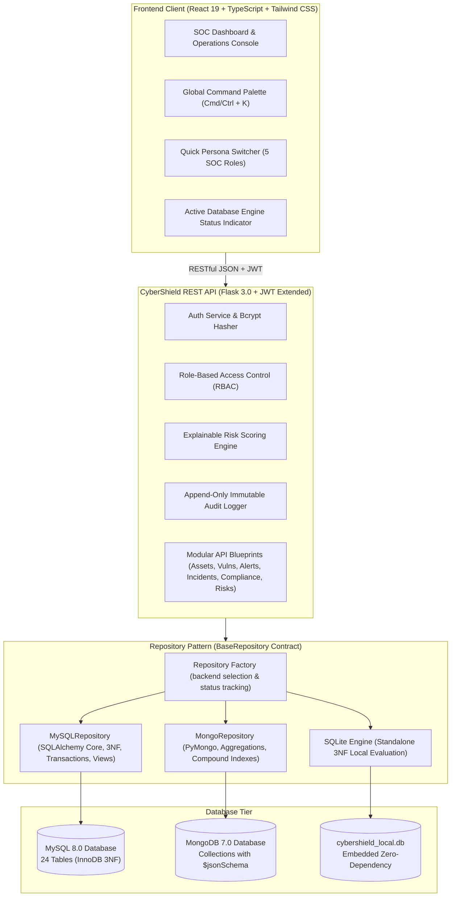
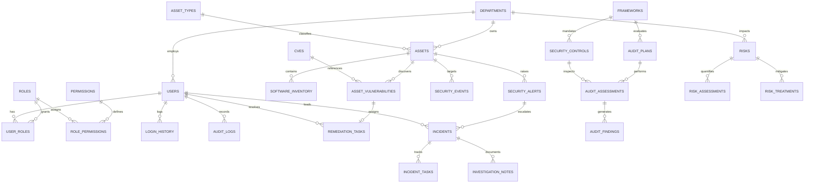

# CyberShield: Enterprise Cybersecurity Risk & Operations Management System

[](https://www.python.org/)
[](https://flask.palletsprojects.com/)
[](https://react.dev/)
[](https://www.typescriptlang.org/)
[](https://www.mysql.com/)
[](https://www.mongodb.com/)
[-success.svg)](https://pytest.org/)

**CyberShield** is an enterprise-grade Security Operations Center (SOC), Vulnerability Management, and Governance, Risk & Compliance (GRC) management platform architected for **Nexora Technologies**. 

Designed to satisfy rigorous Academic Database Management System (DBMS) standards and production SaaS requirements, CyberShield features an interchangeable **Dual-DBMS Repository Architecture** providing 100% functional parity across **MySQL 8.0 (3NF Relational)**, **MongoDB 7.0 (Document Store)**, and a **Standalone Local SQLite Mode** for zero-dependency local evaluation.

---

## 🏛️ System Architecture



---

## 🎯 Key Features

1. **Dual-DBMS Architecture & Repository Pattern**:
   - Clean abstract interface (`BaseRepository`) with interchangeable implementations for MySQL, MongoDB, and standalone SQLite.
   - Transparent database reporting: active database engine is clearly reported on `/api/health`, `/api/dashboard/posture`, and live in the UI header.
   - **Zero silent disguised fallbacks**: If MySQL is selected, CyberShield verifies a live connection. For local demos without Docker or DBMS daemons, `DB_BACKEND=sqlite` runs pure standalone SQLite directly.

2. **Enterprise SOC & Incident Response**:
   - Curated CVE Catalog with CVSS 3.1 vectors, CWE mappings, and active weaponized exploit tracking.
   - Correlation engine mapping 5,000+ raw security events into 400+ deduplicated alerts.
   - NIST SP 800-61 / SANS 6-phase incident response state machine (`OPEN` -> `TRIAGE` -> `CONTAINMENT` -> `ERADICATION` -> `RECOVERY` -> `CLOSED`).
   - One-click cross-module alert-to-incident escalation workflow.

3. **Deterministic Seed Dataset (Nexora Technologies)**:
   - 5 Enterprise Departments (Bengaluru, Pune, Hyderabad)
   - 760 Total Managed Assets (120 Servers, 40 Enterprise Applications, 600 Workstations)
   - Curated CVE library with 400+ findings and active SLA resolution countdowns.
   - Realistic test case: **Asset #5 (`nx-payment-gw-005.nexora.corp`)** with an overdue critical Log4Shell finding breached by 12 days.

4. **Transparent Risk Scoring Engine**:
   - Explainable priority formula combining CVSS base score, asset business criticality, exploit weaponization status, and mitigating controls.
   - 5x5 Likelihood x Impact Heatmap matrix with risk treatment workflows (`MITIGATE`, `ACCEPT`, `TRANSFER`, `AVOID`).

5. **Security, Governance & Compliance (GRC)**:
   - ISO/IEC 27001:2022 and NIST CSF 2.0 frameworks with 64+ security controls.
   - End-to-end audit traceability query: `Control -> Assessment -> Audit Finding -> Corrective Action -> User`.
   - Segregation of Duties (SoD): remediation engineers cannot verify their own fixes.
   - Cryptographic password hashing (Bcrypt, 12 rounds), 5-attempt account lockout threshold, and append-only audit trail.

---

## 📊 Database Design & Relational Schema (MySQL 3NF)

CyberShield's relational database is normalized to **Third Normal Form (3NF)** with 24 relational tables, explicit primary keys, cascading foreign key constraints, composite indexes, and integrity rules.



### Core Table Breakdown

| Domain | Table Name | Purpose & Relationships | Normalization & Constraints |
|---|---|---|---|
| **Access Control** | `departments` | Organizational hierarchy (SecOps, IT, DevOps, Finance, GRC) | Unique `name`, `code`, indexed |
| | `roles`, `permissions` | RBAC role definitions and granular capabilities | 3NF many-to-many junction (`role_permissions`) |
| | `users`, `user_roles` | Enterprise user credentials, departments, and active status | Bcrypt hash, lockout timestamps, unique email |
| | `login_history` | Audit log of authentication attempts (SUCCESS/FAILURE/LOCKED) | Indexed on `(user_id, created_at)` |
| | `audit_logs` | Append-only immutable system event log | No UPDATE/DELETE endpoints, JSON payload support |
| **Assets & CMDB** | `asset_types` | Compute tiers: Server, Endpoint, App, Database, Cloud | Standardized catalog |
| | `assets` | 760 hardware & software nodes across environments | Unique `hostname`, foreign keys to departments & owners |
| | `software_inventory` | Installed packages with version and End-of-Life (EOL) flags | Foreign key to `assets` (CASCADE delete) |
| **Vulnerabilities** | `cves` | CVE catalog with CVSS 3.1 base score, vector, and exploit flags | Unique `cve_id`, CWE category |
| | `asset_vulnerabilities` | Vulnerability findings linked to assets and CVEs | Priority score, SLA deadline, verification metadata |
| | `remediation_tasks` | Operational patch tasks assigned to IT infrastructure staff | Segregation of duties validation against verifier |
| **Alerts & Incidents**| `security_events` | Raw security telemetry (SSH brute force, beaconing, exfiltration) | High-volume ingestion model |
| | `security_alerts` | Correlated threat alerts with deduplication counters | Indexed on `(status, severity)` and `correlation_id` |
| | `incidents` | Security incidents with NIST lifecycle transitions | Mandatory containment, eradication, and post-incident SLA |
| | `incident_tasks`, `investigation_notes` | Timeline notes and containment checklists | Foreign key to `incidents` |
| **Compliance & GRC**| `frameworks` | ISO 27001:2022, NIST CSF 2.0 | Framework versioning |
| | `security_controls` | 64 benchmark controls mapped to domains | Effectiveness score (0.0 - 1.0) |
| | `audit_plans`, `audit_assessments` | Surveillance audits and control status (PASS/FAIL/PARTIAL) | Traceability to lead auditor |
| | `audit_findings` | Findings generated from non-compliant controls | Foreign key to `audit_assessments` |
| **Enterprise Risk** | `risks`, `risk_assessments` | 50+ enterprise risk scenarios with 5x5 heatmap metrics | Likelihood (1-5) * Impact (1-5) scoring |
| | `risk_treatments` | Mitigation strategies, justifications, target dates, approvals | Approval requires Security Manager or Admin |

---

## 🧮 Explainable Risk Priority Formula

Unlike black-box risk algorithms, CyberShield computes a transparent, auditable **Risk Priority Score (0–100)**:

$$\text{Priority} = \min\left(100,\; (\text{CVSS} \times 10) \times W_{\text{asset}} \times M_{\text{exploit}} \times (1 - E_{\text{control}})\right)$$

Where:
- $\text{CVSS}$: Base vulnerability score from 0.0 to 10.0 (e.g., Log4Shell = 10.0 $\to$ base 100).
- $W_{\text{asset}}$ (Asset Criticality Weight):
  - **Tier 1 (Mission-Critical / Core Production)**: $1.30$
  - **Tier 2 (High / Client-Facing API)**: $1.15$
  - **Tier 3 (Medium / Internal Business Ops)**: $1.00$
  - **Tier 4 (Low / Staging & Test)**: $0.85$
  - **Tier 5 (Informational / Sandbox)**: $0.70$
- $M_{\text{exploit}}$ (Exploit Multiplier): Known weaponized exploit / CISA KEV entry = $1.25$; none = $1.00$.
- $E_{\text{control}}$ (Control Effectiveness): Active mitigating controls reduce exposure by up to $50\%$ ($0.0 \le E_{\text{control}} \le 0.50$).
- **Severity Classification**: Critical ($\ge 80.0$), High ($60.0 - 79.9$), Medium ($35.0 - 59.9$), Low ($< 35.0$).

---

## 👥 Demo Personas & Credentials

CyberShield includes five pre-configured personas to test Role-Based Access Control (RBAC), segregation of duties, and operational handoffs:

| Persona Role | Demo Email | Default Password | Responsibilities & Test Workflows |
|---|---|---|---|
| **Security Analyst** | `analyst@nexora.test` | `Nexora@2026` | Alert triage, incident response, correlation investigation, cannot approve risks. |
| **IT Infrastructure Engineer** | `infra@nexora.test` | `Nexora@2026` | Asset owner, remediation task fixer, submits patches. **Cannot verify own fix.** |
| **Compliance Auditor** | `auditor@nexora.test` | `Nexora@2026` | ISO 27001 / NIST CSF audit plans, control testing, raises non-compliance findings. |
| **Security Manager** | `manager@nexora.test` | `Nexora@2026` | Posture review, SLA monitoring, **authorizes risk acceptance and treatments**. |
| **Admin** | `admin@nexora.test` | `Nexora@2026` | Full privileges: user provisioning, role assignments, immutable audit log review. |

---

## 🚀 Quickstart & Setup Guide

### Option 1: Standalone Local Setup (Recommended for Demo & Evaluation)

Run CyberShield locally on any machine with Python 3.11+ and Node.js without needing external database servers.

#### 1. Clone the repository
```bash
git clone https://github.com/teahswi/dbms-project.git
cd dbms-project
```

#### 2. Configure Environment Secrets
```bash
cp .env.example .env
```
*(The default `.env` is pre-configured with `DB_BACKEND=sqlite` for zero-dependency standalone execution).*

#### 3. Setup Python Backend
```bash
# Create and activate virtual environment
python -m venv venv

# Windows PowerShell:
.\venv\Scripts\Activate.ps1
# Linux/macOS:
source venv/bin/activate

# Install dependencies
pip install -r backend/requirements.txt

# Run the deterministic seed script
python backend/app/seeds/seed_data.py

# Start the Flask API server (runs on http://localhost:5000)
python backend/run.py
```

#### 4. Setup React Frontend
Open a second terminal:
```bash
cd frontend

# Install Node dependencies
npm install

# Start Vite dev server (runs on http://localhost:5173)
npm run dev
```

Visit **http://localhost:5173** and log in using any of the quick-switcher persona buttons!

---

### Option 2: Running with Docker Compose (Full Stack with MySQL & MongoDB)

To launch the full enterprise architecture with real MySQL 8.0 and MongoDB 7.0 daemons:

```bash
# Start all containers (MySQL, MongoDB, Backend API, Frontend)
docker compose up -d

# Seed the active database container
docker compose exec backend python app/seeds/seed_data.py
```

To switch backends in Docker, simply set `DB_BACKEND=mysql` or `DB_BACKEND=mongo` in your `.env` file and restart.

---

## 🧪 Automated Testing Suite

CyberShield includes a comprehensive **Pytest** test suite verifying cross-backend parity, authentication, transaction atomicity, segregation of duties, and REST API contracts.

### Run Tests
```bash
cd backend
pytest -v
```

### Test Coverage Highlights
- ✅ **Authentication**: Bcrypt hashing verification, JWT token expiration, account lockout after 5 consecutive failed attempts.
- ✅ **Backend Parity**: Confirms MySQL/SQLite and MongoDB store and compute identical counts for assets (760), incidents (34), risks (51), and controls.
- ✅ **Segregation of Duties**: Enforces that the IT Engineer who fixed a finding cannot verify their own fix (`403 Forbidden`).
- ✅ **RBAC Authorization**: Restricts user provisioning to Admin and risk treatment approval to Security Manager.
- ✅ **Incident State Machine**: Enforces strict NIST incident progression (`OPEN` $\to$ `TRIAGE` $\to$ `CONTAINMENT`).
- ✅ **Database Reporting**: Confirms `/api/health` accurately identifies the active engine and reports any fallback status.

---

## 📡 REST API Reference

| Method | Endpoint | Description | Auth / Role Required |
|---|---|---|---|
| `GET` | `/api/health` | Service health, active database engine, and fallback status | Public |
| `POST` | `/api/auth/login` | Authenticate and obtain JWT access & refresh tokens | Public |
| `GET` | `/api/auth/me` | Fetch authenticated user profile and permissions | JWT Bearer |
| `GET` | `/api/dashboard/posture` | Executive posture score, KPIs, and department exposure | JWT Bearer |
| `GET` | `/api/assets` | Query 760 assets with filters (`environment`, `criticality`) | `ASSET_VIEW` |
| `POST` | `/api/assets` | Provision a new enterprise asset | `ASSET_EDIT` |
| `GET` | `/api/vulnerabilities` | List vulnerability findings with SLA status | `VULN_VIEW` |
| `POST` | `/api/vulnerabilities/calculate-preview` | Compute risk priority score and explainability breakdown | JWT Bearer |
| `POST` | `/api/vulnerabilities/<id>/verify` | Verify remediated finding (enforces Segregation of Duties) | `VULN_VERIFY` (Not fixer) |
| `GET` | `/api/alerts` | Query correlated threat alerts | `ALERT_TRIAGE` |
| `POST` | `/api/alerts/escalate-to-incident` | One-click cross-module incident escalation | `INCIDENT_MANAGE` |
| `PUT` | `/api/incidents/<id>/status` | Update incident status (enforces state machine transitions) | `INCIDENT_MANAGE` |
| `GET` | `/api/compliance/traceability` | End-to-end audit traceability matrix query | `AUDIT_ASSESS` |
| `POST` | `/api/risks/treatments/<id>/approve` | Authorize risk treatment strategy or acceptance | Security Manager / Admin |
| `GET` | `/api/audit-logs` | Query append-only immutable application audit trail | Admin |

---

## 🔒 Repository Hygiene & Security Best Practices

- **Zero Tracked Secrets**: `.env` and local database files are untracked and strictly ignored via root `.gitignore`.
- **Safe Environment Template**: `.env.example` provides documentation placeholders without live credentials.
- **Reproducible Seed Pipeline**: Local databases can be deterministically regenerated at any time with `python backend/app/seeds/seed_data.py`.
- **Lightweight Clean Repository**: Machine-specific virtual environments (`venv/`), build caches, and IDE metadata (`.idea/`) are excluded from version control.

---

## 📄 License & Attribution

Developed for **Nexora Technologies Cybersecurity Management & DBMS Project Demonstration**.  
Architected with modern software engineering standards, clean code principles, and defensive cybersecurity architecture.
